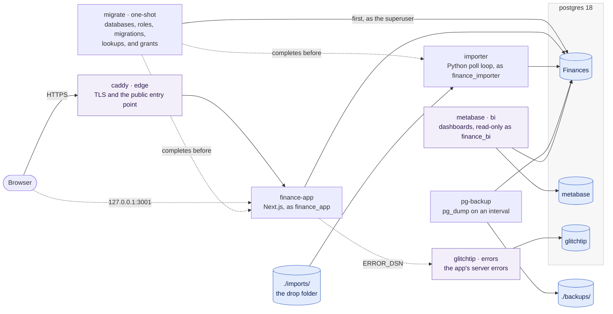
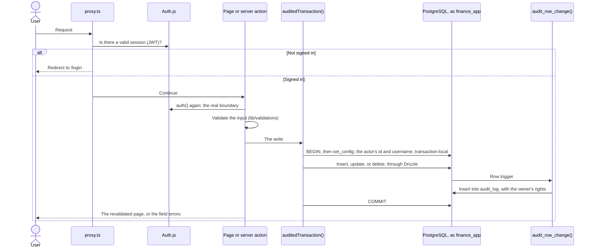
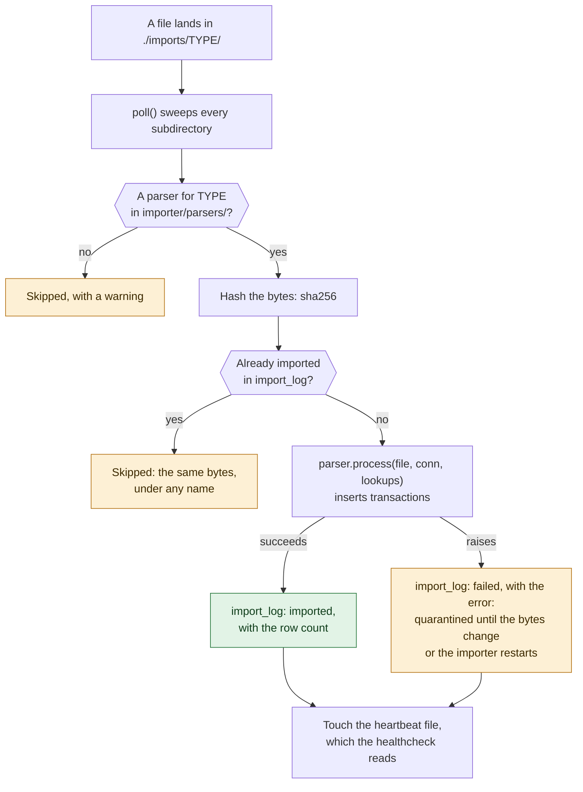
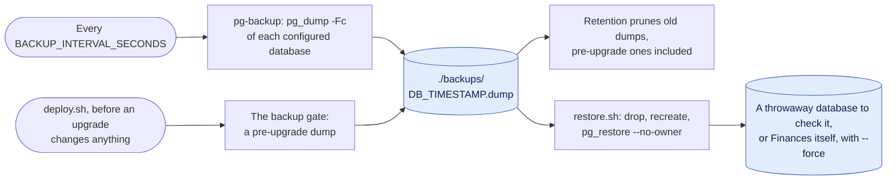
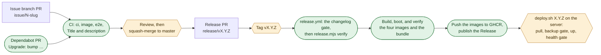
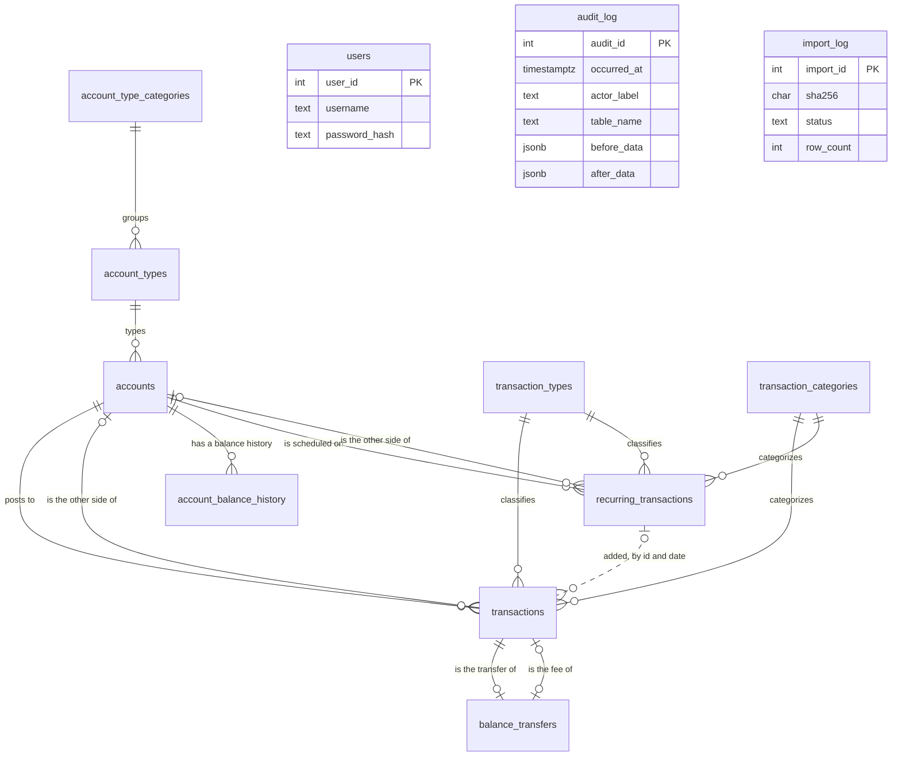

# Architecture

How Finance Stack fits together: a PostgreSQL 18 server holding the data, a Next.js app and a Python
importer that write it, each as its own least-privilege role, and optional services for dashboards,
error tracking, and TLS, all run with Docker Compose. The guides go deep on each part; this page
shows how the parts connect and how data moves between them, and
[the decision records](decisions/README.md) say why the costly-to-reverse choices were made.

## Services and profiles

The services without a profile always run. The others run only when `COMPOSE_PROFILES` in `.env`
lists their profile ([deployment.md](deployment.md#services-and-profiles)).

| Service       | Profile             | Connects as                                            | Responsible for                                                                                                                                       |
| ------------- | ------------------- | ------------------------------------------------------ | ----------------------------------------------------------------------------------------------------------------------------------------------------- |
| `postgres`    | always              |                                                        | `Finances`, plus the `metabase` and `glitchtip` databases for their profiles                                                                          |
| `migrate`     | always, then exits  | `POSTGRES_USER`, the superuser                         | Creates the databases and the service roles, applies the Drizzle migrations and the grants, and seeds the lookups (`app/scripts/migrate-and-seed.sh`) |
| `finance-app` | always              | `finance_app`                                          | The web app and its server actions: reads and writes the core tables, and only reads `users` and `audit_log`                                          |
| `importer`    | always              | `finance_importer`                                     | Imports the files dropped in `./imports/`, one parser per subdirectory; append-only on `transactions` ([importer.md](importer.md))                    |
| `pg-backup`   | always              | `POSTGRES_USER`                                        | Dumps each configured database to `./backups/` on an interval, and restores ([backups.md](backups.md))                                                |
| `metabase`    | `bi`                | `finance_bi` for the data, `metabase_user` for its own | Dashboards over the core tables and views, never `users` or `audit_log`                                                                               |
| `glitchtip`   | `errors`            | `glitchtip`                                            | Collects the app's server errors ([observability.md](observability.md#error-tracking))                                                                |
| `caddy`       | `edge`              |                                                        | Terminates TLS and forwards to `finance-app`                                                                                                          |
| `init-script` | `init`, run by hand | `POSTGRES_USER`                                        | Rebuilds the account balance history ([database.md](database.md))                                                                                     |

`scripts/verify-db-roles.sh` asserts the grant matrix behind the "Connects as" column in CI, and
fails on any login role it doesn't expect ([database.md](database.md)).

## An app request

Every page and server action is behind sign-in, and every write runs in an audited transaction, so
the audit log names who made each change without the app being able to write the log itself.

- **Signing in:** the Credentials provider checks the username and password hash in `users`, and
  issues a JWT session; there is no session table ([auth.md](auth.md)).
- **The audit log:** a `SECURITY DEFINER` trigger writes it, so the importer's inserts and anything
  done in `psql` are recorded too, and `finance_app` can only read it
  ([audit-log.md](audit-log.md)).
- **Errors:** server errors go to GlitchTip when `ERROR_DSN` is set, and to the structured log
  either way ([observability.md](observability.md)).

## Importing a file

The importer never moves or deletes a file: what it has done with each one is a row in `import_log`,
keyed on the file's content.

The parsers themselves are gitignored and mounted read-only, so CI tests the loop against a fake
parser. Each parser resolves every lookup by name, never by id ([importer.md](importer.md)).

## Backups and restores

The `backup-smoke` workflow runs a dump and a restore every week. The image that dumps is built on
the same PostgreSQL tag as the server, because `pg_dump` refuses a newer server
([backups.md](backups.md)).

## From a change to a deployment

An image that fails its own boot-and-health check never reaches the registry. On the server,
`deploy.sh` rolls the application back to the previous version if the new one fails its health gate;
the database comes back only from the pre-upgrade dump, because the migrations have no down steps
([releases.md](releases.md), [deployment.md](deployment.md)).

## Data model

The core tables, as Drizzle defines them in `app/drizzle/schema.ts`. Every insert, update, and
delete on them is recorded in `audit_log`; the views (`v_transactions_full`,
`v_account_balances_current`, `v_daily_totals`, and `v_audit_log`) read over them.

`users`, `audit_log`, and `import_log` stand apart: the audit log names its actor by id and label
rather than by a foreign key, so it outlives the user, and the import log is keyed on content.
Schema changes go through a migration ([schema-changes.md](schema-changes.md)), and each release
says whether it can be rolled back ([releases.md](releases.md)).
